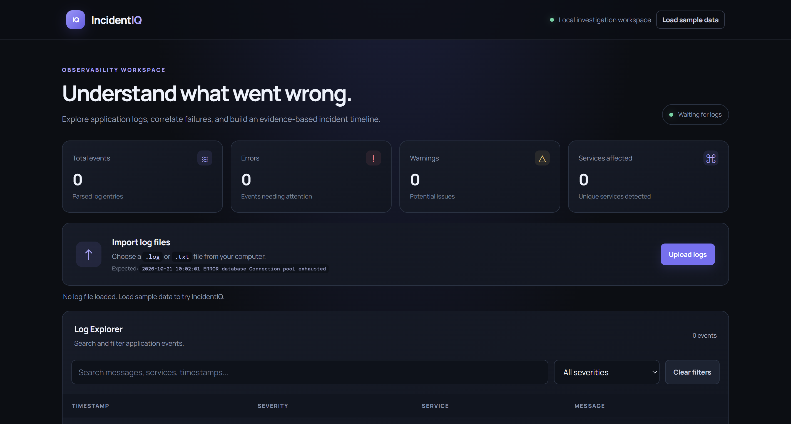

# ⚡ IncidentIQ

### From scattered logs to connected incidents.

**IncidentIQ** is a browser-based incident investigation dashboard that transforms raw application logs into structured events, correlated incidents, and evidence-backed root-cause hypotheses.

Built with **HTML · CSS · JavaScript** — no frameworks, no dependencies, just core web technologies.
--- 
<p align="center">
  
  
  
  
</p>

---

## ✦ The Problem

When a service goes down, application logs rarely tell the whole story in one place. Developers must search through timestamps, identify error patterns, and connect events across services to understand what might have failed.

**IncidentIQ brings those investigative steps into one workspace.**

Instead of manually scanning hundreds of log lines, developers can filter events, trace incident timelines, discover clusters of related failures, and inspect the evidence behind possible causes.

## ◈ Features

<table>
<tr>
<td width="50%">

### 📥 Log Ingestion
Upload `.log` and `.txt` files directly from your computer.

</td>
<td width="50%">

### 📊 Live Metrics
Track total events, errors, warnings, and unique services.

</td>
</tr>
<tr>
<td width="50%">

### 🔎 Log Explorer
Search messages and filter events by severity.

</td>
<td width="50%">

### 🕒 Incident Timeline
Trace events chronologically to understand the sequence of failures.

</td>
</tr>
<tr>
<td width="50%">

### 🔗 Event Correlation
Group nearby warnings and errors into potential incident clusters.

</td>
<td width="50%">

### 🧠 Root Cause Analysis
Generate rule-based hypotheses supported by relevant log entries.

</td>
</tr>
</table>

## ◉ See It in Action

> ## Preview

<p align="center">
  
</p>

## ⚙️ How It Works

```text
       RAW APPLICATION LOGS
                 │
                 ▼
          ┌─────────────┐
          │ Log Parser  │
          └──────┬──────┘
                 ▼
          ┌─────────────┐
          │ Event Data  │
          └──────┬──────┘
                 ▼
       ┌───────────────────┐
       │ Search & Filtering│
       └─────────┬─────────┘
                 ▼
       ┌───────────────────┐
       │ Event Correlation │
       └─────────┬─────────┘
                 ▼
       ┌───────────────────┐
       │ Root Cause Rules  │
       └─────────┬─────────┘
                 ▼
       INCIDENT INSIGHTS
```

### Investigation pipeline

1. **Ingest** — Read the selected log file in the browser.
2. **Parse** — Extract timestamps, severity, service, and message.
3. **Filter** — Narrow events by keywords and severity.
4. **Correlate** — Group warning and error events within a five-minute window.
5. **Investigate** — Display potential causes and their supporting evidence.

## 🛠️ Tech Stack

| Technology | Role |
|---|---|
| HTML5 | Semantic dashboard structure |
| CSS3 | Dark theme, responsive layout, interface styling |
| Vanilla JavaScript | Parsing, filtering, correlation, and analysis |
| Browser File API | Client-side file reading |

No framework or package installation is required for the current prototype.

## 🚀 Run Locally

### Prerequisites

- A modern web browser
- [Visual Studio Code](https://code.visualstudio.com/)
- //

### Installation

```bash
git clone https://github.com/Palak150104/incidentiq.git
cd incidentiq
```

Open the folder in VS Code, launch `index.html` using Live Server, and select **Load sample data** or upload a supported log file.

## 🧪 Sample Log Format

```text
2026-10-21 10:02:01 INFO api Request received
2026-10-21 10:02:02 ERROR database Connection pool exhausted
2026-10-21 10:02:03 ERROR api Database query timed out
2026-10-21 10:02:04 WARN api Response latency above threshold
2026-10-21 10:02:05 ERROR gateway Upstream request failed: 504
```

IncidentIQ uses these events to demonstrate log exploration, event correlation, and rule-based root-cause hypotheses.

## 📁 Project Structure

```text
incidentiq/
├── index.html
├── style.css
├── script.js
├── README.md
└── samples/
    └── outage.log
```

## 🧩 Engineering Highlights

- Parsing structured text into usable event objects
- Handling file uploads and malformed log entries
- Dynamically rendering filtered results
- Grouping time-related events using date comparisons
- Generating diagnostic hypotheses from event patterns
- Separating evidence from inferred explanations

**Design principle:** Correlated events are clues, not proof of causation. IncidentIQ presents rule-based hypotheses for investigation rather than claiming that a root cause has been definitively established.

## 🗺️ Roadmap

- [x] Interactive dashboard interface
- [x] Log upload and parsing
- [x] Search and severity filtering
- [x] Incident timeline
- [x] Event correlation
- [x] Rule-based root-cause hypotheses
- [ ] Automated tests for parsing and correlation
- [ ] Configurable correlation windows
- [ ] Error-rate and severity visualizations
- [ ] Node.js ingestion API
- [ ] PostgreSQL event storage
- [ ] Service dependency mapping
- [ ] Real-time log streaming and alerting

## 🔮 The Vision

IncidentIQ starts as a lightweight frontend prototype and provides a foundation for a more complete incident investigation platform.

The next stage is to move beyond browser-only processing toward persistent event storage, service dependency awareness, configurable correlation, and automated testing.

## 👩‍💻 Author

**Palak**

Aspiring Software Engineer | Building projects focused on practical engineering problems.

- GitHub: [@Palak150104](https://github.com/Palak150104)

---

<p align="center">
  <strong>IncidentIQ</strong><br>
  <em>Investigate the evidence. Connect the events. Understand the incident.</em>
</p>
